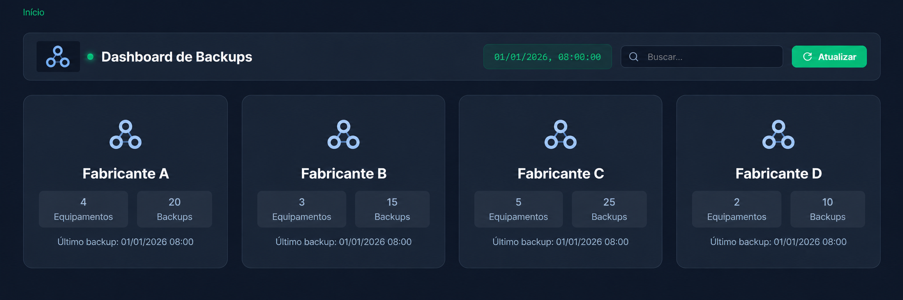

# Backup Manager


Painel Flask para consultar e baixar backups de configuração de equipamentos Brocade, Juniper, Datacom e Fortinet. Foi projetado para uso na rede interna. Os diretórios de backup são montados no container somente para leitura.

## Funcionalidades

- Navegação por fornecedor, equipamento e versões de backup.
- Busca na tela atual por fornecedor, equipamento ou nome de arquivo.
- Data do último backup e estado de cada equipamento: **Em dia**, **Atrasado**, **Sem backup** ou **Diretório indisponível**.
- Destaque da versão mais recente e download pelo nome original do arquivo.
- Suporte a arquivos diretamente na raiz do fornecedor ou em subpastas por equipamento.
- Relógio e datas no fuso `America/Manaus`.

## Instalação com Docker Compose

Requisitos: Docker com o comando `docker compose`.

```bash
git clone https://github.com/Pliffisson/dashboard-backup.git
cd dashboard-backup/backup-manager
cp .env.example .env
```

Edite o `.env` com os caminhos **absolutos** dos diretórios de backup no host:

```dotenv
BROCADE_BACKUP_DIR=/caminho/para/backups/brocade
JUNIPER_BACKUP_DIR=/caminho/para/backups/juniper
DATACOM_BACKUP_DIR=/caminho/para/backups/datacom
FORTINET_BACKUP_DIR=/caminho/para/backups/fortinet
BACKUP_STALE_HOURS=24
BACKUP_CACHE_SECONDS=60
BACKUP_PORT=5005
```

Depois, inicie o serviço:

```bash
docker compose up -d --build
```

Abra `http://localhost:5005` no próprio servidor ou use o endereço interno do servidor com a porta configurada. Para verificar o estado e os logs:

```bash
docker compose ps
docker compose logs --tail=50 backup-manager
```

O `.env` é ignorado pelo Git e pela construção da imagem. Nunca adicione arquivos reais de backup ao repositório.

## Estrutura dos backups

O aplicativo reconhece dois formatos, que podem coexistir dentro de um fornecedor:

```text
/caminho/para/backups/fabricante-a/
├── DISPOSITIVO_A/
│   ├── DISPOSITIVO_A_20260101_080000.conf
│   └── DISPOSITIVO_A_20251231_080000.conf
└── DISPOSITIVO_B/
    └── DISPOSITIVO_B_20260101_080000.conf
```

```text
/caminho/para/backups/fabricante-b/
├── DISPOSITIVO_C_20260101_080000.conf
└── DISPOSITIVO_C_20251231_080000.conf
```

No formato plano, o nome do equipamento é extraído do prefixo anterior a `AAAAMMDD_HHMMSS`. Arquivos que não seguem esse padrão aparecem no grupo **Geral**. O painel lê somente arquivos da raiz ou do primeiro nível de subpastas; pastas mais profundas não são exibidas. Arquivos ocultos e links simbólicos são ignorados.

## Estados e atualização

O estado **Atrasado** é aplicado quando a data de modificação do arquivo mais recente ultrapassa `BACKUP_STALE_HOURS` (24 horas por padrão). Uma pasta de equipamento vazia aparece como **Sem backup**. Se uma pasta não puder ser lida, aparece como **Diretório indisponível**. A data mostrada é a data de modificação do arquivo, no fuso de Manaus.

O inventário fica em memória por `BACKUP_CACHE_SECONDS` (60 segundos por padrão), por processo. O botão **Atualizar** força uma nova varredura. Falhas de leitura são registradas no log sem impedir a exibição dos demais fornecedores.

## Segurança e uso interno

O aplicativo não implementa login. Restrinja o acesso à porta configurada à rede e aos usuários autorizados pela infraestrutura da empresa. Os volumes `:ro` impedem que o container altere os arquivos de backup. O download só aceita arquivos presentes no inventário do equipamento selecionado.

## Pastas do projeto

```text
backup-manager/
├── .env.example           # Modelo de configuração; copie para .env
├── app.py                 # Rotas, inventário e downloads
├── docker-compose.yml     # Serviço e volumes configuráveis
├── Dockerfile             # Imagem da aplicação
├── requirements.txt       # Dependências Python
├── static/
│   ├── style.css          # Estilos do painel
│   └── img/               # Logos
├── templates/
│   └── index.html         # Interface
└── docs/
    └── screenshots/       # Imagem demonstrativa
```

## Demonstração visual



*Imagem ilustrativa com nomes, quantidades e datas fictícios.*
